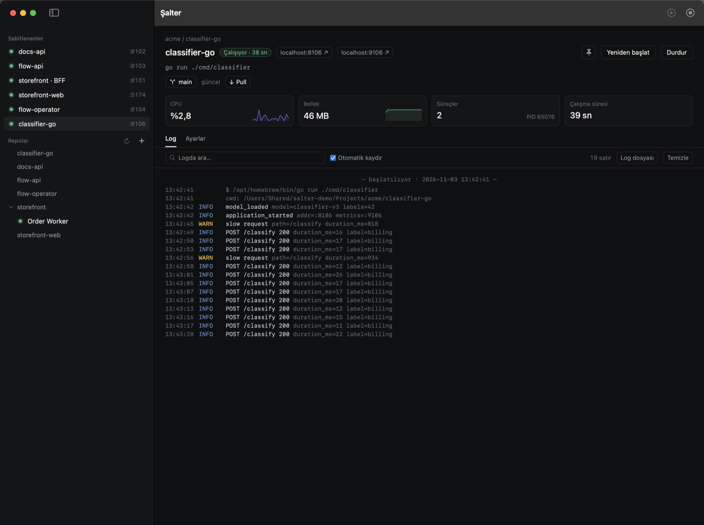
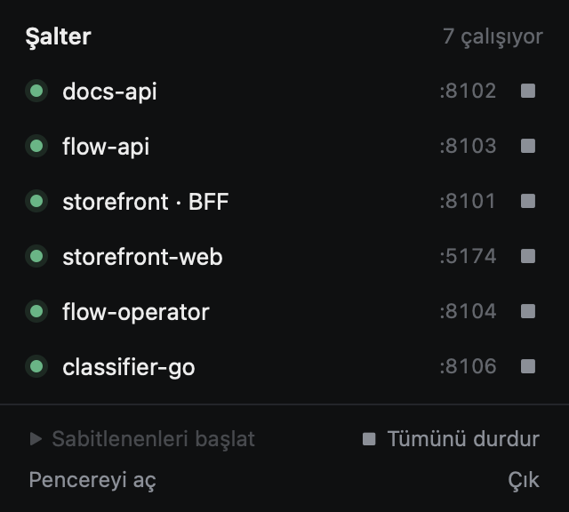

# Şalter

Şalter is a macOS menu-bar and window app that discovers the dev services in your local repos and lets you start, stop and watch them without opening VS Code or a terminal.



<p align="center"></p>

- **Discovery:** finds services in `.vscode/launch.json`, `package.json` and project files (Go, Rust, Java, .NET).
- **Pinned services:** start or stop all of them with one click from the menu bar or the window.
- **Readable logs:** time and level columns, with JSON and logfmt lines parsed.
- **Resources:** CPU, memory, process count and uptime per service, with a 5-minute history.
- **Git:** see the branch, switch to local or remote branches, and pull (fast-forward only).

The internal name is `salter` (package, bundle id `com.etokalak.salter`, folders).

## Requirements

- macOS 14 or later, Apple Silicon (arm64)
- To build: Command Line Tools (`xcode-select --install`). Xcode is not required.

## Install from a ready build

1. Download `Salter.zip` from [Releases](https://github.com/emrahtokalak/salter/releases/latest), unzip it and move `Salter.app` into `/Applications`.
2. If the build is not notarized, macOS blocks it on first launch. Remove the block with:

   ```sh
   xattr -dr com.apple.quarantine /Applications/Salter.app
   ```

3. Open the app. Add the folder that holds your projects (default `~/Projects`) with **+ → Taranacak klasör ekle…** in the sidebar.

## Build from source

```sh
git clone https://github.com/emrahtokalak/salter.git
cd salter
make test       # unit and integration tests
make install    # build, sign, install to ~/Applications/Salter.app
open ~/Applications/Salter.app
```

| Command | What it does |
|---|---|
| `make build` | Debug build |
| `make test` | Tests (Swift Testing); `make test FILTER=GitRepoTests` runs one suite |
| `make app` | Signed release `build/Salter.app` |
| `make install` | `make app` + copy to `~/Applications` |
| `make zip` | Signed app as `build/Salter.zip` for sharing |
| `make dist` | Sign, notarize, staple, install (needs `make notary-setup` once) |
| `make verify` | Check the signature and Gatekeeper |
| `make run` | Run the release binary without a bundle (no notifications or launch at login) |

**Signing:** if the keychain has a `Developer ID Application` certificate, it is used automatically; otherwise the app is signed ad-hoc. Override with `make app SIGN_ID=-` or `SIGN_ID="Developer ID Application: …"`.

**Notarization:**
- Without it, Gatekeeper rejects the app (`Unnotarized Developer ID`).
- Run `make notary-setup` once; it stores your Apple ID, Team ID and an [app-specific password](https://appleid.apple.com/account/manage) in the keychain.
- After that, `make dist` is enough.

**SDK:**
- With Command Line Tools only, the macOS 27 SDK fails to build because `@State` became a macro (`SwiftUIMacros` ships only with Xcode).
- The Makefile therefore pins the newest `MacOSX26*.sdk`.
- To pick another SDK: `make SDKROOT=/path/to/MacOSX.sdk app`.

## How it works

| Source | Becomes |
|---|---|
| `launch.json` · `debugpy` / `python` | The `.venv` Python; uvicorn gets a reload switch |
| `launch.json` · `go` | `go run <program>`, or the binary when `mode: exec` |
| `launch.json` · `node` / `pwa-node` | `runtimeExecutable` + `runtimeArgs`, or `node <program>` |
| `launch.json` · `lldb` (CodeLLDB) | `cargo run …` from the `cargo` block |
| `package.json` | The `dev` / `start` script with npm, yarn or pnpm |
| `go.mod` | `go run` for each `cmd/<name>` and the root `package main` |
| `Cargo.toml` | `cargo run [-p] [--bin]` for each binary (workspaces included) |
| `pom.xml`, `build.gradle(.kts)` | Spring Boot / exec / application; uses `mvnw` / `gradlew` when present |
| `*.csproj` | `dotnet run --project` (test projects skipped) |

- **Fallbacks:** project files are read only for languages that `launch.json` produced no service for. `java` and `coreclr` launch configs are skipped in favour of the project file.
- **Environment:** `<repo>/.env` plus the config's `env`, layered the same way as in VS Code.
- **Processes:** each service runs in its own process group. Stopping sends SIGTERM to the whole group, then SIGKILL after 5 seconds.
- **Git:** commands never prompt, a fetch times out after 60 seconds, and pull is fast-forward only. Switching branches is refused while there are uncommitted changes.

| File | Location |
|---|---|
| Settings | `~/Library/Application Support/Salter/config.json` |
| Logs | `~/Library/Logs/Salter/` |

## Project layout

```
Sources/SalterCore    Discovery, config, process management, log parsing, git (pure, tested)
Sources/Salter        SwiftUI app: menu bar, window, views
Tests/SalterCoreTests Unit and integration tests (Fixtures/: sample launch.json / package.json)
docs/superpowers      Design and implementation plans
```

## Out of scope

Attaching a debugger, docker-compose, Makefile target discovery, automatic restart, and commit, push or merge.
